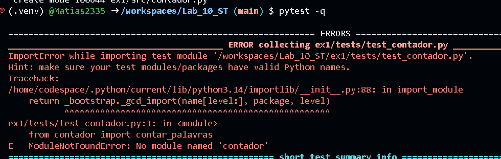
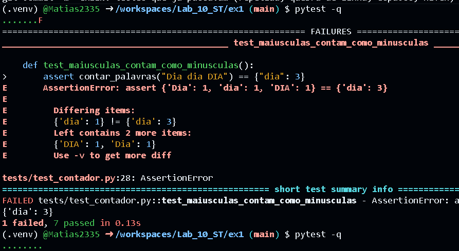
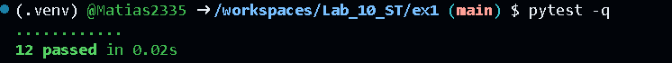
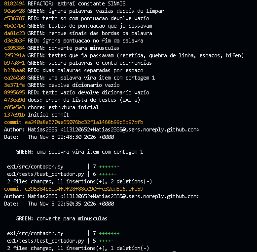
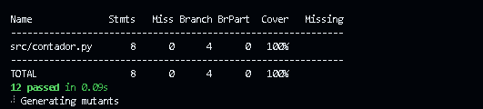
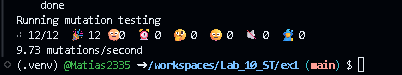

# Laboratório 10 - TDD

## Exercício 1 - Contador de Palavras

### a) Ordem da lista de testes (do mais simples ao mais exigente)

| # | Teste | Por que nesta posição |
|---|---|---|
| 1 | `""` dá `{}` | caso degenerado: só exige que a função exista e devolva um `dict` |
| 2 | `"teste"` dá `{"teste": 1}` | primeira contagem, com uma só palavra e sem separar nada |
| 3 | `"bom dia"` dá dois itens | obriga a separar as palavras |
| 4 | `"dia a dia"` dá `{"dia": 2, "a": 1}` | repetição de palavras |
| 5 | `"bom\ndia"` dá dois itens | quebra de linha como separador |
| 6 | três espaços entre `bom` e `dia` dão dois itens | espaços repetidos |
| 7 | `"guarda-chuva"` dá um item | hífen interno faz parte da palavra |
| 8 | `"Dia dia DIA"` dá `{"dia": 3}` | primeira regra de normalização (maiúsculas) |
| 9 | `"fim. Fim!"` dá `{"fim": 2}` | sinais no fim da palavra |
| 10 | `",dia, ;dia;"` dá `{"dia": 2}` | sinais nas duas bordas |
| 11 | `":dia: ?dia?"` dá `{"dia": 2}` | outros sinais nas bordas |
| 12 | `"... !"` dá `{}` | a palavra fica vazia depois de limpar os sinais |

**Justificativa das duas primeiras posições:**

- **1º, `""` dá `{}`:** é o caso mais simples possível. O teste só obriga a criar a função e devolver um dicionário, sem nenhuma lógica. Dá o primeiro passo mínimo do ciclo vermelho-verde.
- **2º, `"teste"` dá `{"teste": 1}`:** é o primeiro teste que obriga a função a olhar o texto e contar. Ele traz a ideia de contagem com uma única palavra, sem exigir a separação de palavras, que só aparece no 3º teste (`"bom dia"`).

A partir daí a ordem vai do mais simples ao mais exigente: primeiro separar e contar (3 a 7), depois normalizar maiúsculas (8) e por fim tratar a pontuação (9 a 12).

### b) Desenvolvimento com TDD

Um commit por fase, seguindo a ordem do item (a): RED só no teste, GREEN só no código, REFACTOR com a suíte verde antes e depois.

**Prints a colar:**

Fases:

| Ciclo | Teste | RED? | Código acrescentado |
|---|---|---|---|
| 1 | `""` | sim | `return {}` |
| 2 | `"teste"` | sim | caso de uma palavra |
| 3 | `"bom dia"` | sim | `split()` e contagem |
| 4 a 7 | repetida, `\n`, 3 espaços, hífen | não, já passavam | nenhum |
| 8 | `"Dia dia DIA"` | sim | `lower()` |
| 9 | `"fim. Fim!"` | sim | `strip(".,;:!?")` |
| 10 e 11 | sinais nas bordas | não, já passavam | nenhum |
| 12 | `"... !"` | sim | `if palavra:` |
| Refactor | - | - | constante `SINAIS` |

### c) `git log --oneline`

**Algum GREEN veio sem RED antes?** Sim.

- `GREEN: uma palavra vira item com contagem 1` (ciclo 2) e `GREEN: converte para minusculas` (ciclo 8) não têm um commit `RED:` antes deles. (Conferir com `git show --stat` e ajustar: *o teste novo foi commitado junto com o código / o RED não foi commitado separadamente*.)
- `GREEN: testes que ja passavam (...)` (ciclos 4 a 7) e `GREEN: testes de pontuacao que ja passavam` (ciclos 10 e 11) também vieram sem RED, por natureza: o teste já passava, então nunca houve fase vermelha.

Os demais ciclos (1, 3, 9 e 12) têm RED antes do GREEN.

### d) Testes que passaram na primeira execução

| Teste | Por que já passava |
|---|---|
| `"dia a dia"` | a contagem com `get` do ciclo 3 já soma repetições |
| `"bom\ndia"` | `split()` sem argumento separa por qualquer espaço em branco, inclusive `\n` |
| três espaços | `split()` sem argumento trata espaços repetidos como um só separador |
| `"guarda-chuva"` | `split()` não separa por hífen |
| `",dia, ;dia;"` e `":dia: ?dia?"` | `strip(".,;:!?")` já remove qualquer combinação desses sinais nas duas bordas |

Eles **ficam na suíte**: não guiaram código novo, mas documentam o contrato e protegem contra regressão (por exemplo, trocar `split()` por `split(" ")` quebraria os testes de `\n` e de espaços repetidos).

### e) Cobertura e mutação da suíte final

| Medida | Resultado |
|---|---|
| Cobertura de comandos | 100% |
| Cobertura de ramos | 100% |
| Mutantes gerados / mortos / vivos | 12 / 12 / 0 |
| Escore de mutação (MS) | 100% |

Nota: o mutmut 3.8.0 não muta constantes de módulo. Depois do REFACTOR, a string `".,;:!?"` virou a constante `SINAIS` e saiu da análise. Antes do refactor (string dentro de `strip`) eram 13 mutantes e 1 sobrevivia: `strip("XX.,;:!?XX")`, **equivalente**, porque o texto já está em minúsculas e nunca começa nem termina com `X`.