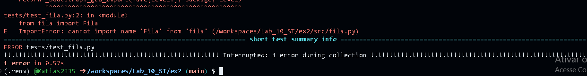
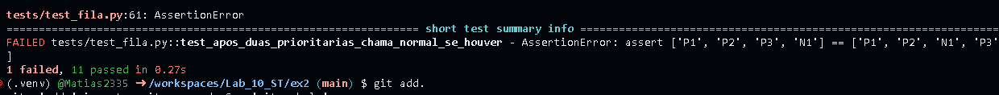
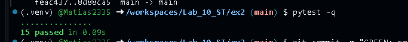
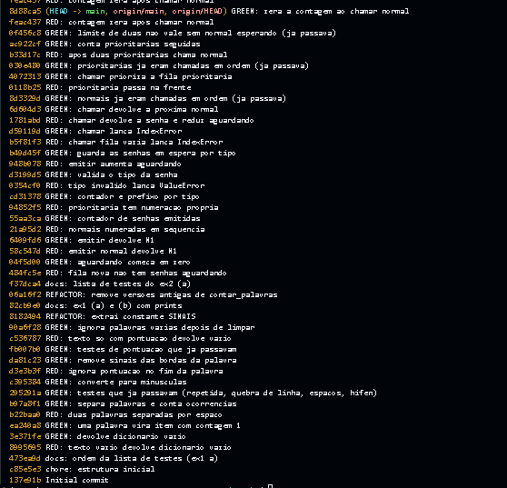
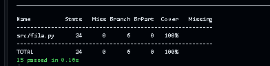
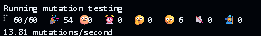
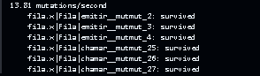

# Laboratório 10 - TDD

## Exercício 1 - Contador de Palavras

### a) Ordem da lista de testes (do mais simples ao mais exigente)

| # | Teste | Por que nesta posição |
|---|---|---|
| 1 | `""` dá `{}` | caso degenerado: só exige que a função exista e devolva um `dict` |
| 2 | `"teste"` dá `{"teste": 1}` | primeira contagem, com uma só palavra e sem separar nada |
| 3 | `"bom dia"` dá dois itens | obriga a separar as palavras |
| 4 | `"dia a dia"` dá `{"dia": 2, "a": 1}` | repetição de palavras |
| 5 | `"bom\ndia"` dá dois itens | quebra de linha como separador |
| 6 | três espaços entre `bom` e `dia` dão dois itens | espaços repetidos |
| 7 | `"guarda-chuva"` dá um item | hífen interno faz parte da palavra |
| 8 | `"Dia dia DIA"` dá `{"dia": 3}` | primeira regra de normalização (maiúsculas) |
| 9 | `"fim. Fim!"` dá `{"fim": 2}` | sinais no fim da palavra |
| 10 | `",dia, ;dia;"` dá `{"dia": 2}` | sinais nas duas bordas |
| 11 | `":dia: ?dia?"` dá `{"dia": 2}` | outros sinais nas bordas |
| 12 | `"... !"` dá `{}` | a palavra fica vazia depois de limpar os sinais |

**Justificativa das duas primeiras posições:**

- **1º, `""` dá `{}`:** é o caso mais simples possível. O teste só obriga a criar a função e devolver um dicionário, sem nenhuma lógica. Dá o primeiro passo mínimo do ciclo vermelho-verde.
- **2º, `"teste"` dá `{"teste": 1}`:** é o primeiro teste que obriga a função a olhar o texto e contar. Ele traz a ideia de contagem com uma única palavra, sem exigir a separação de palavras, que só aparece no 3º teste (`"bom dia"`).

A partir daí a ordem vai do mais simples ao mais exigente: primeiro separar e contar (3 a 7), depois normalizar maiúsculas (8) e por fim tratar a pontuação (9 a 12).

### b) Desenvolvimento com TDD

Um commit por fase, seguindo a ordem do item (a): RED só no teste, GREEN só no código, REFACTOR com a suíte verde antes e depois.

**Prints a colar:**

Fases:

| Ciclo | Teste | RED? | Código acrescentado |
|---|---|---|---|
| 1 | `""` | sim | `return {}` |
| 2 | `"teste"` | sim | caso de uma palavra |
| 3 | `"bom dia"` | sim | `split()` e contagem |
| 4 a 7 | repetida, `\n`, 3 espaços, hífen | não, já passavam | nenhum |
| 8 | `"Dia dia DIA"` | sim | `lower()` |
| 9 | `"fim. Fim!"` | sim | `strip(".,;:!?")` |
| 10 e 11 | sinais nas bordas | não, já passavam | nenhum |
| 12 | `"... !"` | sim | `if palavra:` |
| Refactor | - | - | constante `SINAIS` |
| Refactor 2 | - | - | remoção das versões antigas de `contar_palavras` que ficaram no arquivo |

### c) `git log --oneline`

**Algum GREEN veio sem RED antes?** Sim.

- `GREEN: uma palavra vira item com contagem 1` (ciclo 2) e `GREEN: converte para minusculas` (ciclo 8) não têm um commit `RED:` antes deles. (Conferir com `git show --stat` e ajustar: *o teste novo foi commitado junto com o código / o RED não foi commitado separadamente*.)
- `GREEN: testes que ja passavam (...)` (ciclos 4 a 7) e `GREEN: testes de pontuacao que ja passavam` (ciclos 10 e 11) também vieram sem RED, por natureza: o teste já passava, então nunca houve fase vermelha.

Os demais ciclos (1, 3, 9 e 12) têm RED antes do GREEN.

### d) Testes que passaram na primeira execução

| Teste | Por que já passava |
|---|---|
| `"dia a dia"` | a contagem com `get` do ciclo 3 já soma repetições |
| `"bom\ndia"` | `split()` sem argumento separa por qualquer espaço em branco, inclusive `\n` |
| três espaços | `split()` sem argumento trata espaços repetidos como um só separador |
| `"guarda-chuva"` | `split()` não separa por hífen |
| `",dia, ;dia;"` e `":dia: ?dia?"` | `strip(".,;:!?")` já remove qualquer combinação desses sinais nas duas bordas |

Eles **ficam na suíte**: não guiaram código novo, mas documentam o contrato e protegem contra regressão (por exemplo, trocar `split()` por `split(" ")` quebraria os testes de `\n` e de espaços repetidos).

### e) Cobertura e mutação da suíte final

| Medida | Resultado |
|---|---|
| Cobertura de comandos | 100% |
| Cobertura de ramos | 100% |
| Mutantes gerados / mortos / vivos | 12 / 12 / 0 |
| Escore de mutação (MS) | 100% |

Nota: o mutmut 3.8.0 não muta constantes de módulo. Depois do REFACTOR, a string `".,;:!?"` virou a constante `SINAIS` e saiu da análise. Antes do refactor (string dentro de `strip`) eram 13 mutantes e 1 sobrevivia: `strip("XX.,;:!?XX")`, **equivalente**, porque o texto já está em minúsculas e nunca começa nem termina com `X`.

## Exercício 2 - Fila de Atendimento

### a) Lista de testes (escrita antes de codificar)

| # | Teste | Regra verificada |
|---|---|---|
| 1 | fila nova tem `aguardando == 0` | estado inicial |
| 2 | `emitir("normal")` devolve `"N1"` | formato da senha normal |
| 3 | duas normais devolvem `N1` e `N2` | numeração em sequência |
| 4 | `N1`, `P1`, `N2`, `P2` | numeração separada por tipo |
| 5 | `emitir("vip")` lança `ValueError` | tipo inválido |
| 6 | emitir duas senhas dá `aguardando == 2` | contagem de espera |
| 7 | `chamar()` em fila vazia lança `IndexError` | fila vazia |
| 8 | `chamar()` devolve `"N1"` e `aguardando` cai para 0 | chamar remove da espera |
| 9 | `N1`, `N2` são chamadas nessa ordem | ordem de chegada (normais) |
| 10 | `N1` e depois `P1`: chama `P1` primeiro | prioritária passa na frente |
| 11 | `P1`, `P2` são chamadas nessa ordem | ordem de chegada (prioritárias) |
| 12 | `N1`, `P1`, `P2`, `P3`: chama `P1, P2, N1, P3` | após 2 prioritárias seguidas, chama normal |
| 13 | `P1`, `P2`, `P3` sem normal: chama `P1, P2, P3` | limite de 2 não vale sem normal esperando |
| 14 | `N1`, `N2`, `P1` a `P4`: chama `P1, P2, N1, P3, P4, N2` | a contagem zera depois da normal |
| 15 | após `P1, P2, P3` chamadas, entram `N1` e `P4`: chama `N1` | normal que chega depois do limite passa na frente |

### b) Desenvolvimento com TDD

Um commit por fase: RED só no teste, GREEN só no código.

| Ciclo | Teste | RED? | Código acrescentado |
|---|---|---|---|
| 1 | fila nova | sim | `aguardando` devolve 0 |
| 2 | `N1` | sim | `emitir` devolve `"N1"` |
| 3 | `N1`, `N2` | sim | contador de emitidas |
| 4 | numeração por tipo | sim | contador e prefixo por tipo |
| 5 | tipo inválido | sim | `ValueError` |
| 6 | `aguardando` | sim | listas de espera |
| 7 | `chamar` vazia | sim | `IndexError` |
| 8 | `chamar` devolve a senha | sim | `pop(0)` da normal |
| 9 | normais em ordem | não, já passava | nenhum |
| 10 | prioritária na frente | sim | `chamar` prioriza |
| 11 | prioritárias em ordem | não, já passava | nenhum |
| 12 | 2 seguidas, depois normal | sim | contador `_seguidas` |
| 13 | limite sem normal | não, já passava | nenhum |
| 14 | contagem zera | sim | `_seguidas = 0` |
| 15 | normal depois do limite | não, já passava | nenhum |

| Refactor | - | - | remoção das versões antigas da classe Fila que ficaram no arquivo |

### c) Testes que obrigaram a contar e a zerar

- **Contar as prioritárias seguidas:** `test_apos_duas_prioritarias_chama_normal_se_houver` (`N1, P1, P2, P3` deve sair `P1, P2, N1, P3`). Só uma implementação que lembra quantas prioritárias saíram em sequência passa nesse teste.
- **Zerar a contagem:** `test_contagem_de_prioritarias_zera_apos_chamar_normal` (`N1, N2, P1 a P4` deve sair `P1, P2, N1, P3, P4, N2`). Sem zerar, o contador continua em 2 depois da `N1`, e a `N2` sairia antes da `P3` (`P1, P2, N1, N2, P3, P4`).

### d) Limite de 2 sem normal esperando

`test_limite_de_duas_nao_vale_sem_normal_esperando`: com `P1, P2, P3` e nenhuma normal na fila, a ordem é `P1, P2, P3`. A terceira prioritária sai mesmo com o contador em 2, porque a regra só manda chamar normal "se houver normal esperando". Esse teste passou de primeira, pois a condição `and self._espera["normal"]` já era exigida pelo teste do ciclo 12.

### e) Cobertura e mutação

| Medida | Resultado |
|---|---|
| Testes | 15 passando |
| Cobertura de comandos e ramos | 100% |
| Mutantes gerados / mortos / vivos | 60 / 54 / 6 |
| Escore de mutação (MS) | 54/60 = 90% |

**Os vivos indicam comportamento da especificação sem teste? Não.** Os 6 são mutações do **texto** das mensagens de `ValueError("tipo invalido")` e `IndexError("fila vazia")` (`None`, `"XX...XX"`, maiúsculas). A especificação define só o **tipo** das exceções, e não as mensagens, e os testes conferem o tipo. Todas as regras (numeração, prioridade, limite de 2 e zeramento) têm mutantes mortos.

Se o texto das mensagens fizesse parte do contrato, bastaria conferi-las com `match="^tipo invalido$"` e `match="^fila vazia$"`, o que leva a 60/60 (100%).

Observação: `aguardando` é uma `@property`, e o mutmut 3.8.0 não gera mutantes para ela (os 60 são de `__init__`, `emitir` e `chamar`). Os testes dela guiaram o TDD, mas o escore não a avalia.